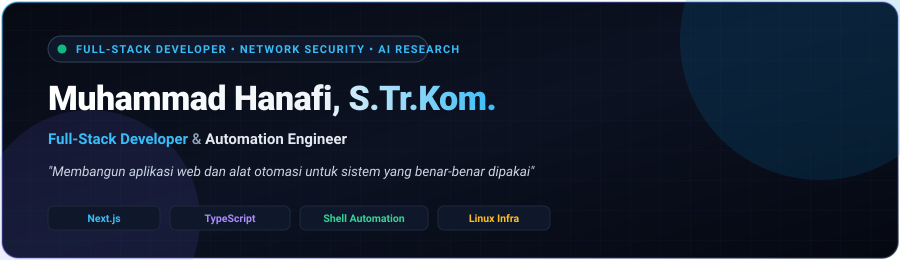

  

---

### 🧠 Engineering Vision & Philosophy

> **"The best code is the code never written. Engineering is not about accumulating abstractions; it is about building high-leverage systems with zero-bloat, deterministic reliability, and extreme mechanical sympathy."**

I am a **Lead AI Engineer**, **Full-Stack Systems Architect**, and the Founder of **Gahar Inovasi Teknologi**. My engineering focus spans autonomous neural agent orchestration, high-throughput distributed media pipelines, low-overhead edge networks, and resilient self-sovereign infrastructure.

- 🪜 **The Minimality Ladder**: Solve problems at the lowest viable layer—standard library over third-party bloat, native OS primitives over heavy runtimes, shortest working diffs.
- ⚡ **Mechanical Sympathy & Fast I/O**: Designing software around NVMe sequential access, cache lines, zero-copy buffers, and sub-millisecond edge latency.
- 🌐 **Edge-First Self-Sovereignty**: Sovereign microservices hosted on hardened Linux VPS clusters with Cloudflare TLS 1.3 edge termination, PM2 process supervision, and automated CI/CD pipelines.

---

### 🚀 Flagship Products & Ecosystem

<table>
  <tr>
    <td width="50%" valign="top">
      <h4>🧠 <a href="https://claudiacode.zolu.my.id">Claudia Autonomous AI Engine</a></h4>
      
<b>Autonomous Senior Engineering Agent &amp; Terminal IDE (Claudia 5.0 Max)</b>

      <ul>
        <li>Dual-tier cognitive reasoning with autonomous AST self-healing loop.</li>
        <li>Powerline HUD, 29 standardized slash commands, and multi-agent delegation.</li>
        <li>Bilingual autonomous orchestration with <i>Minimality Ladder</i> heuristics.</li>
      </ul>
      

        
        
      

    </td>
    <td width="50%" valign="top">
      <h4>🎬 <a href="https://goblix.my.id">Goblix Streaming Platform</a></h4>
      
<b>High-Throughput Media &amp; Torrent Acceleration Streaming Engine</b>

      <ul>
        <li>Full-pipeline parallel torrent ingest (50+ simultaneous streams) with instant playback.</li>
        <li>Dual-engine HLS/MP4 transcoding and real-time multi-language subtitle synchronization.</li>
        <li>Clean, cinema-grade enterprise dual-theme SaaS interface.</li>
      </ul>
      

        
        
      

    </td>
  </tr>
  <tr>
    <td width="50%" valign="top">
      <h4>🔒 <a href="https://kudisk.my.id">KUDISK Cloud Storage</a></h4>
      
<b>Private Encrypted Cloud Storage &amp; High-Speed File Management</b>

      <ul>
        <li>Zero-knowledge client-side encryption and high-throughput chunked uploads.</li>
        <li>NVMe-accelerated flat-file document store with instant file previews.</li>
        <li>Integrated Superadmin tier, quota metering, and automated storage lifecycle.</li>
      </ul>
      

        
        
      

    </td>
    <td width="50%" valign="top">
      <h4>🛡️ <a href="https://ndes.my.id">NDES Edge Firewall</a></h4>
      
<b>Next-Gen DNS-over-HTTPS (DoH) &amp; Edge Network Filtering Firewall</b>

      <ul>
        <li>Ultra-low latency recursive DoH resolver with threat intelligence blocking.</li>
        <li>Custom rule-based filtering, telemetry analytics, and zero-logging privacy.</li>
        <li>Enterprise SaaS dashboard with real-time query stream inspection.</li>
      </ul>
      

        
        
      

    </td>
  </tr>
  <tr>
    <td colspan="2" valign="top">
      <h4>📹 <a href="https://ngomel.my.id">NGOMEL Real-Time Collaboration</a></h4>
      
<b>Real-Time Ultra Low Latency Video Conferencing &amp; Workspace Collaboration</b>

      <ul>
        <li>Peer-to-peer WebRTC mesh architecture with selective forwarding optimizations.</li>
        <li>Sub-50ms glass-to-glass latency, spatial audio isolation, and high-fidelity screen sharing.</li>
        <li>Integrated meeting rooms, encrypted signaling channel, and zero-plugin web client.</li>
      </ul>
      

        
        
      

    </td>
  </tr>
</table>

---

### 🛠️ Technical Stack & Engineering Weapons

<table>
  <tr>
    <td width="22%"><b>Core Languages</b></td>
    <td>
      
      
      
      
      
      
      
      
    </td>
  </tr>
  <tr>
    <td><b>Frontend &amp; UI</b></td>
    <td>
      
      
      
      
      
    </td>
  </tr>
  <tr>
    <td><b>Backend &amp; Runtimes</b></td>
    <td>
      
      
      
      
      
    </td>
  </tr>
  <tr>
    <td><b>AI &amp; Autonomous Engines</b></td>
    <td>
      
      
      
      
      
    </td>
  </tr>
  <tr>
    <td><b>Databases &amp; State</b></td>
    <td>
      
      
      
      
    </td>
  </tr>
  <tr>
    <td><b>DevOps &amp; Infrastructure</b></td>
    <td>
      
      
      
      
      
      
    </td>
  </tr>
</table>

---

### 📊 GitHub Activity & Metrics

  

---

### 📬 Connect & Collaborate

Have an ambitious systems engineering challenge, AI architecture initiative, or enterprise partnership? Let's connect:

- 🌐 **Personal Portfolio:** [zolu.my.id](https://zolu.my.id)
- 💼 **WhatsApp Direct:** [+62 851-9590-1080](https://wa.me/6285195901080)
- ✉️ **Email:** [mhanafi09051998@gmail.com](mailto:mhanafi09051998@gmail.com)
- 🐙 **GitHub:** [@mhanafi09051998](https://github.com/mhanafi09051998)

  © 2026 <b>Muhammad Hanafi</b> • Founder of <b>Gahar Inovasi Teknologi</b> • Built with precision &amp; zero-bloat.

